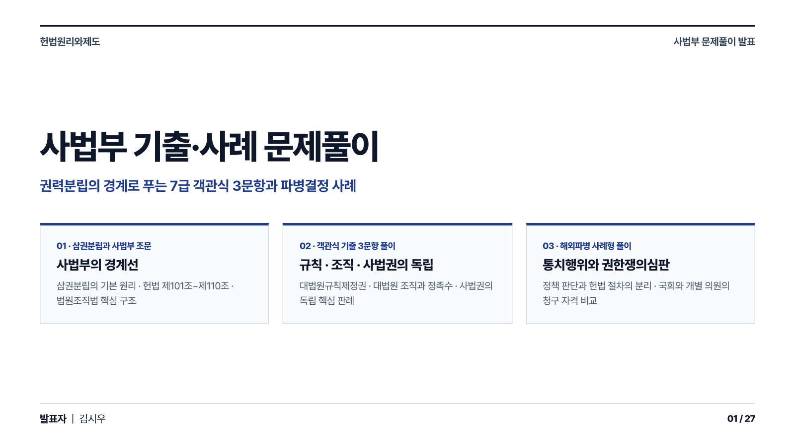
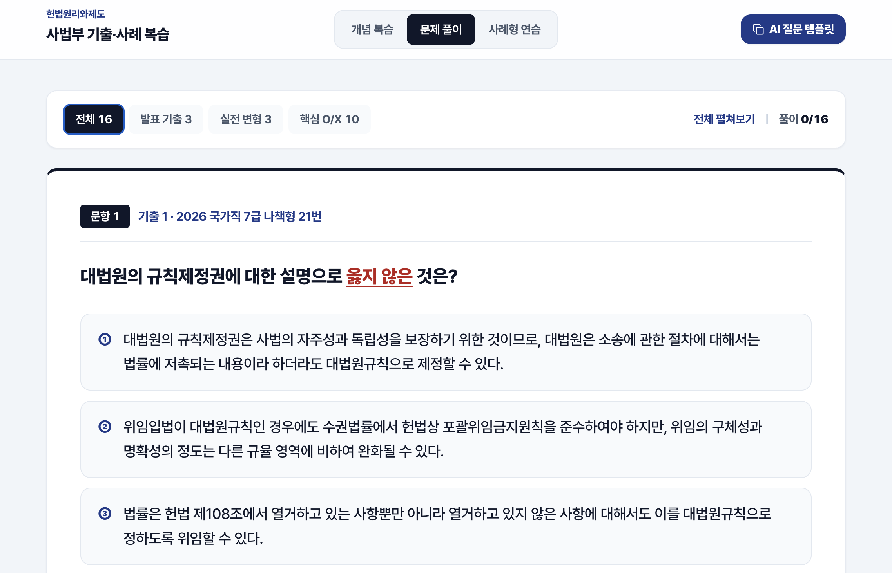

# 사법부 기출·사례 문제풀이 (헌법원리와제도)

국민대학교 법학부 『헌법원리와제도』 사법부 파트 발표 교안(PDF) 및 기출·사례 자율 복습 웹페이지 아카이브입니다.

- **복습 웹페이지 바로가기**: [https://kmu-court.netlify.app/](https://kmu-court.netlify.app/)
- **발표 교안 PDF 바로 열기 / 다운로드**: [https://kmu-court.netlify.app/slides.pdf](https://kmu-court.netlify.app/slides.pdf) *(단축 주소: `kmu-court.netlify.app/pdf`)*
- **GitHub 내 PDF 뷰어로 보기**: [public/slides.pdf](./public/slides.pdf)
- **발표자**: 김시우 (`codeup38@kookmin.ac.kr`)

---

## 1. 발표 교안 (전 27페이지)

[](https://kmu-court.netlify.app/slides.pdf)

> **관통 질문**: *“사법부(법원과 헌법재판소)는 어디까지 판단할 수 있고, 어디서 멈춰야 하는가?”*

| 구간 | 페이지 | 주요 내용 |
|---|---|---|
| **도입 · 구조와 조문** | `01 ~ 05p` | 삼권분립상 각 기관의 경계선, 헌법 제101조~제110조 핵심 뼈대, 규범 서열(제107조 명령·규칙 심사), 법원조직법 3기구 및 대법관 정원 변화(현행 14명 → 2030년 26명, 법률 제21451호 부칙) |
| **객관식 문제 1** | `06 ~ 09p` | **2026 국가직 7급 나책형 21번** — 대법원규칙제정권(헌법 제108조 법률우위 원칙, 위임 구체성 완화 `2013헌바370`, 비열거 사항 법률 위임, 대법관회의 의결) |
| **객관식 문제 2** | `10 ~ 13p` | **2026 국가직 7급 나책형 25번** — 최소 형량과 양형재량(`99헌바43`), 법관인사위원회(위원장 포함 11명), 대법관회의(대법원장 부의 · 전원 2/3 출석), 명령·규칙 위헌·위법 시 `대법관 전원의 3분의 2 이상의 합의체` 심판(법원조직법 제7조 제1항) |
| **객관식 문제 3** | `14 ~ 17p` | **2025 국가직 7급 가책형 24번** — 사법권의 독립 합헌 결정례 분석(판사 근무평정 위임 및 연임 제외 `2015헌바331`, 특가법 법정형 하한 `96헌바16`, 파산관재인 선임 `2001헌가1` 다수의견 vs 소수 반대의견 위장 함정) |
| **해외파병 사례형** | `18 ~ 26p` | **통치행위와 권한쟁의심판 3단계 검토** — ① 조약 비준동의(제60조①)와 국군 해외파견 사전동의(제60조②) 분리, ② 이라크 파병 결정(`2003헌마814`)의 절차 준수 전제와 사법심사 범위, ③ 국회 전체 청구(적법) vs 개별 의원 청구(제3자 소송담당 불허 · 심의·표결권 대내성 각하 `2011헌라2`) 및 4단 서술형 답안 구성 |
| **복습 웹페이지 안내** | `27p` | 모바일·PC 기출 복습 웹앱 및 학교 무료 제공 AI 연계 자율 학습 안내 |

---

## 2. 인터랙티브 복습 웹페이지

[](https://kmu-court.netlify.app/)

별도 회원가입이나 백엔드 서버 없이 모바일·태블릿·PC 브라우저(`localStorage`)에서 바로 학습할 수 있도록 구성했습니다.

1. **개념 복습**: 삼권분립 구조도, 헌법 제107조 규범 서열과 헌법 제101~110조 조문 정리, 법원조직법 3기구 비교 및 2030년 대법관 증원 정족수 계산기, 핵심 합헌 판례 4선 정리
2. **문제 풀이 (총 16문항)**: 발표 기출 3문항 · 실전 변형 4지선다 3문항 · 핵심 O/X 10문항 즉시 채점, 틀린 구절 X-Ray 취소선 교정, 오답 모아보기
3. **사례형 연습**: 해외파병 사례 원문과 타임라인 양방향 대조, 3단계 핵심 쟁점 점검, 4단 서술형 답안 핵심 키워드 가려보기 및 초안 논점 자동 체크리스트
4. **탑다운(Top-down) AI 질문 템플릿**: 모범답안 단순 통출력이나 스무고개식 질문 대신 **전체 관문 구조도(뼈대) 제시 → 핵심 갈림길 분해 및 재구성** 순서로 지도받도록 설계된 맞춤형 프롬프트 생성기 (기말고사 타 헌법 판례·사례 범용 템플릿 포함)

---

## 3. 로컬 실행 및 빌드

```bash
npm install
npm run dev
npm run build
```
